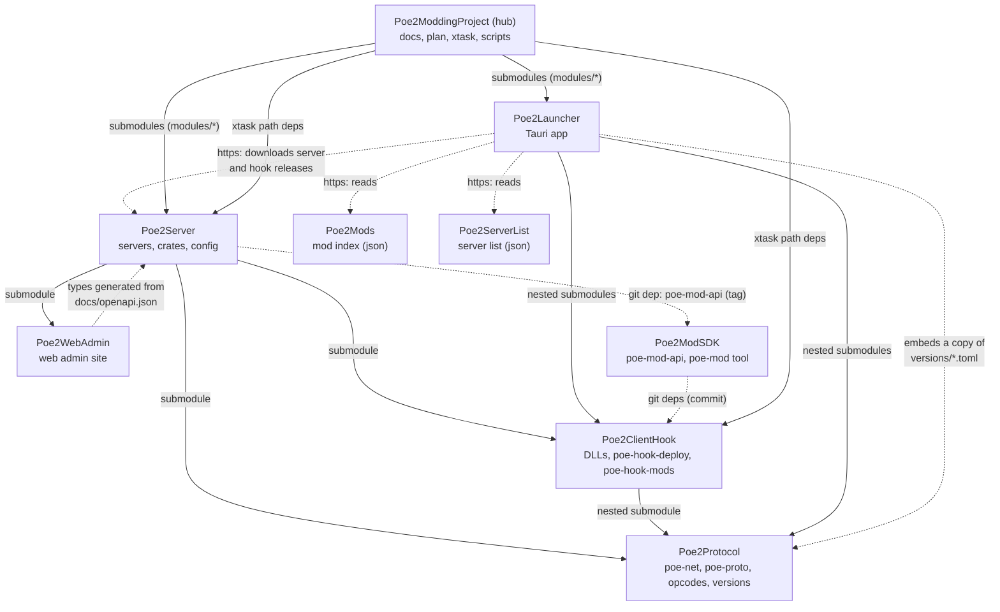

# Project overview

The Path of Exile 2 (client 0.5.5e Hotfix 1) private server project spans nine repositories under [`WaystoneWorks`](https://github.com/WaystoneWorks). Rules for all of them: [../CLAUDE.md](../CLAUDE.md).

## The repositories

| Repository | Where in the hub | What it is |
|---|---|---|
| [**Poe2ModdingProject**](https://github.com/WaystoneWorks/Poe2ModdingProject) (hub) | `/` | Docs, plan, RE notes and scripts, dev tooling (`xtask`: deploy the hook, build the DLLs, `check-build`, run the server). Has every other repository as a submodule under `modules/`. No releases. |
| [**Poe2Server**](https://github.com/WaystoneWorks/Poe2Server) | `modules/server` | Login server, instance server, web API, accounts, terrain generator, mod host, config. Builds and tests on its own. Releases `server-v*`. |
| [**Poe2Protocol**](https://github.com/WaystoneWorks/Poe2Protocol) | `modules/protocol` | Wire protocol crates (`poe-net`, `poe-proto`), opcode tables `opcodes/<version>/`, supported-build definitions `versions/<version>.toml`. |
| [**Poe2ClientHook**](https://github.com/WaystoneWorks/Poe2ClientHook) | `modules/client-hook` | Client DLLs (loader, debug core with overlay, mod loader), signature table, `poe-hook-deploy`, `poe-hook-mods` (mod manifest and packages, shared with launcher, server and SDK). Releases `hook-v*`. |
| [**Poe2WebAdmin**](https://github.com/WaystoneWorks/Poe2WebAdmin) | `modules/web-admin` | Web admin site (Svelte 5), served by the server and packaged in its releases. |
| [**Poe2Launcher**](https://github.com/WaystoneWorks/Poe2Launcher) | `modules/launcher` | Player and host launcher (Tauri 2): installs the client from Steam depots, deploys the hook, starts the game at its login screen pointed at the selected server, hosts servers, manages mods. Releases `v*` (signed auto-update). |
| [**Poe2ModSDK**](https://github.com/WaystoneWorks/Poe2ModSDK) | `modules/mod-sdk` | SDK for mod authors: server mod C ABI (`poe-mod-api`), safe wrappers, the `poe-mod` tool (new, pack, verify), examples. Releases `v*`. |
| [**Poe2Mods**](https://github.com/WaystoneWorks/Poe2Mods) | `modules/mod-index` | Public mod index (`index.json`, schema, validator, CI). The launcher's mod browser reads it. |
| [**Poe2ServerList**](https://github.com/WaystoneWorks/Poe2ServerList) | `modules/server-list` | Public server list (`servers.json`, schema, validator, CI). The launcher's server browser reads it. |

## Dependencies



Solid arrows are build-time dependencies, dotted arrows are pinned git dependencies, generated or copied files, and runtime downloads. Every repository builds on its own after `git clone --recursive`; the hub is needed only for docs, plan and client tooling.

- **Poe2Protocol** depends on nothing. `versions/<version>.toml` is the single definition of a supported client build (depots, exe fingerprint, opcode folder, signature table, accepted client hashes, data anchors).
- **Poe2ClientHook** nests Poe2Protocol (`modules/client-hook/protocol`).
- **Poe2Server** has Poe2Protocol, Poe2ClientHook (`poe-hook-shared`, `poe-hook-mods`) and Poe2WebAdmin as submodules, and `poe-mod-api` as a git dependency pinned by tag.
- **Poe2Launcher** nests Poe2ClientHook and Poe2Protocol, embeds a copy of the version files (`cargo xtask versions` keeps it in step), and talks to servers through their web API.
- **Poe2WebAdmin**'s API types are generated from the server's `docs/openapi.json` (`npm run gen:api`); the file is committed in both repositories.
- **Poe2ModSDK** takes the manifest parser and client ABI crate from Poe2ClientHook as git dependencies pinned to a commit.
- **The hub**'s `xtask` uses the server's crates (`poe-config`, `poe-data`, `poe-world`, `poe-proto`) and the hook's `poe-hook-deploy` and `poe-hook-sig` as path dependencies.

A change across repositories is committed bottom-up: inside the submodule first, then the pointer above ([../CONTRIBUTING.md](../CONTRIBUTING.md#submodules)).

## Releases

| What | Repository | Tag | Contents | How |
|---|---|---|---|---|
| Server | Poe2Server | `server-v<version>` | `poe-server` for Linux and Windows with example config, version files, opcode tables, data schema, web admin; SHA-256 sums | [releasing.md](../modules/server/docs/releasing.md) |
| Launcher | Poe2Launcher | `v<version>` | Linux and Windows installers, signed update manifest | [guides/launcher.md](guides/launcher.md#releasing) |
| Client hook | Poe2ClientHook | `hook-v<version>` | The DLLs, `poe-hook.toml`, `release.json` | [guides/releasing-hook.md](guides/releasing-hook.md) |
| SDK | Poe2ModSDK | `v<version>` | `poe-mod` tool and crates | the SDK's README |

`server-v0.1.0` and `server-v0.2.0` live in this repository.

## Getting started

- **Player.** Install the [launcher](https://github.com/WaystoneWorks/Poe2Launcher/releases) and follow [guides/client.md](guides/client.md).
- **Host.** The launcher's *Host a server* page, or a [server release](https://github.com/WaystoneWorks/Poe2Server/releases) by hand: [hosting.md](../modules/server/docs/hosting.md). Server mods: [guides/modding.md](guides/modding.md).
- **Developer.**

  ```sh
  git clone --recursive https://github.com/WaystoneWorks/Poe2ModdingProject.git
  cd Poe2ModdingProject
  third_party/fetch-tools.sh        # external tools, pinned (cargo-xwin, schema, Python env, ...)
  cargo build                       # xtask
  cargo xtask server build          # the server (modules/server)
  cargo xtask server run            # run it from the hub (config modules/server/config/server.toml)
  cargo xtask build-dll             # the client DLLs (modules/client-hook)
  python3 scripts/check-links.py    # the docs' links
  ```

  The server alone needs no hub: `git clone --recursive https://github.com/WaystoneWorks/Poe2Server && cd Poe2Server && cargo build && cargo test`. Details: [guides/setup.md](guides/setup.md), [run](guides/setup.md#run).

## Which folder holds what

| Need | Look in |
|---|---|
| Rules, plan | [../CLAUDE.md](../CLAUDE.md), [PLAN.md](PLAN.md) |
| Server config, crates, servers | `modules/server/` ([architecture/crates.md](architecture/crates.md)) |
| Opcodes, supported builds | `modules/protocol/opcodes/<version>/`, `modules/protocol/versions/<version>.toml` |
| Client DLLs, signatures | `modules/client-hook/` ([architecture/client-dll.md](architecture/client-dll.md)) |
| Datamined outputs, runtime data, client copy | `dumps/<version>/`, `runtime/`, `GameFiles/` (git-ignored, in the hub) |
